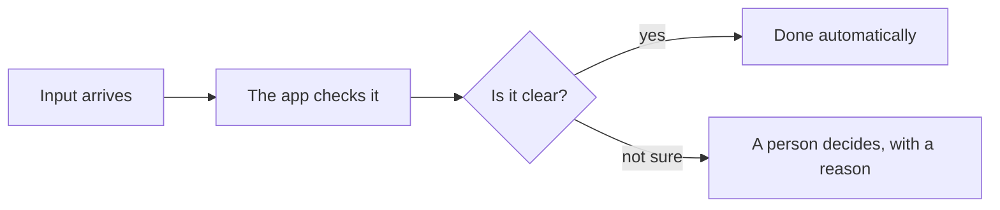
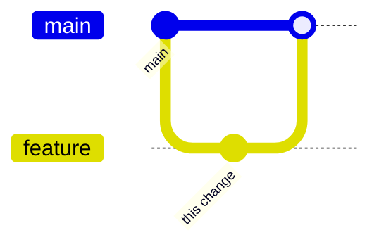

# Plain-language summary comment (rule R10)
Post ONE extra comment with this shape when a PR is final (findings fixed, ready for the last review or merge). Write for someone who does not program: no jargon, or explain a term in five words. Diagrams may use the whole page; the repo host renders fenced `mermaid` blocks. Sign it `**<Role> · <Vendor>:**`. The technical comments stay as they are.

## What this changes (2 to 4 sentences)
...

## How it works (workflow diagram)

## Before and after (branches or behaviour)

Plus a small "Before / After" table of what a person sees.

## What a person will notice
- ...

## What did NOT change / what could go wrong
- ...

## How we know it works
- tests, who reviewed, CI status, numbers (say which are measured and which are estimates)

## Status
- approvals with exact commits; what still must happen before merge
